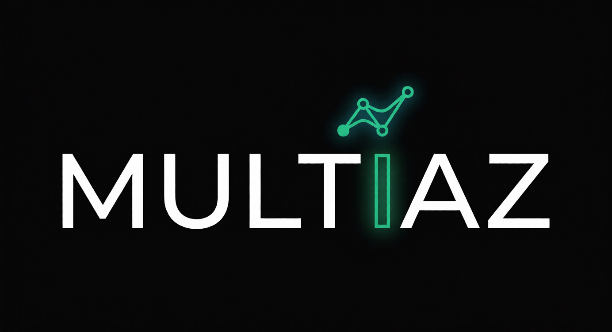
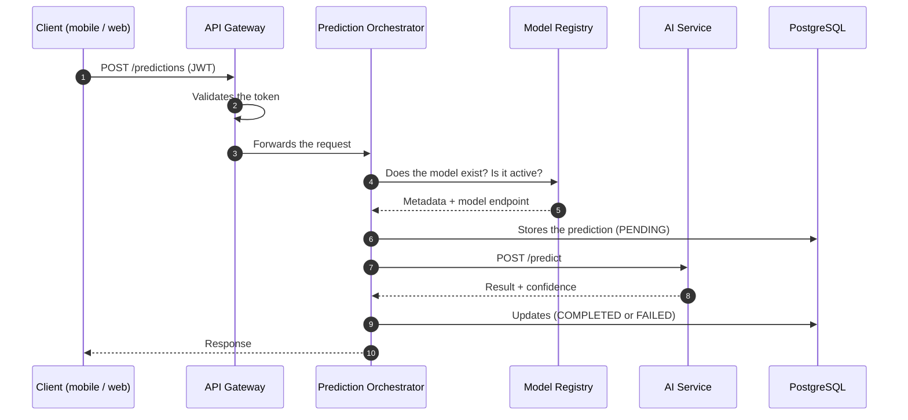
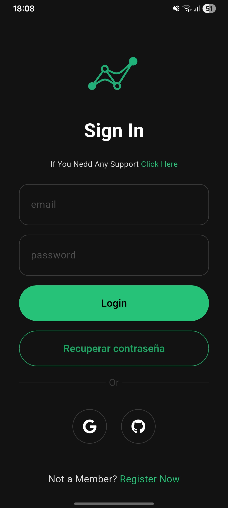
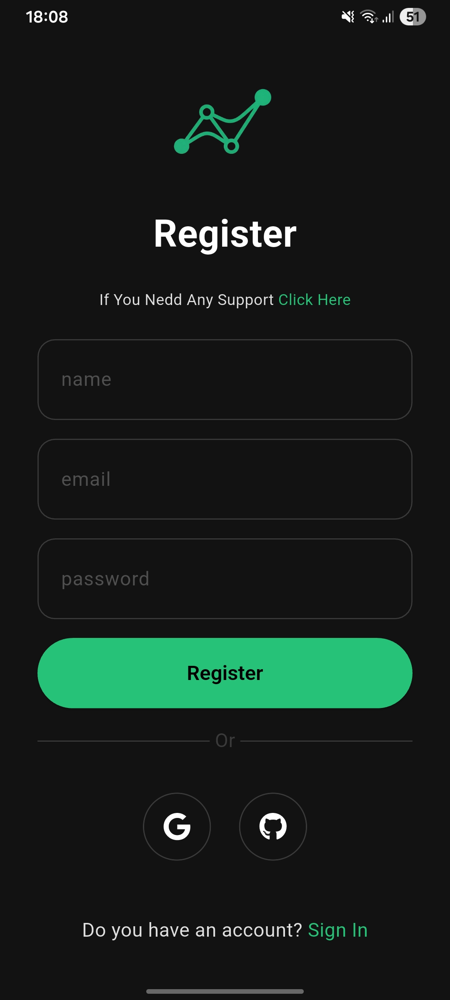

<p align="center"><a href="README.md">Español</a> · <strong>English</strong></p>

<div align="center">
    
    <h3>A platform to run AI models as plugins</h3>
    <br/>
    
    
    <br/><br/>
    
    
    
    
    
    <br/>
    
    
    
    
    
    
</div>

<br/>

> **MultIAZ** is a microservices platform to **register, serve and operate AI models** behind a single entry point. Each model is an independent service that follows a common contract, so a model can be added, enabled or retired without touching the rest of the system.

---

## Table of contents

- [Why does it exist?](#why-does-it-exist)
- [How a prediction works](#how-a-prediction-works)
- [Current status](#current-status)
- [Architecture decisions](#architecture-decisions)
- [Monorepo structure](#monorepo-structure)
- [Running locally](#running-locally)
- [Roadmap](#roadmap)
- [Documentation](#documentation)
- [Author](#author)

---

## Why does it exist?

Training a model is the easy part. The hard part starts when there are **several models in production**, each with its own API, its own version, its own way of failing and its own resource usage. Without a common layer, every client ends up talking directly to every model and the system becomes impossible to maintain.

MultIAZ is that common layer:

- **A single entry point.** Clients (mobile app and web panel) only know the API Gateway, never the address of a model.
- **Models as plugins.** A new model is registered in the *Model Registry* and the orchestrator routes to it with no code changes.
- **Controlled lifecycle.** A model can be active or inactive, and the orchestrator rejects requests to inactive models.
- **Traceability.** Every prediction is stored with its input, output, status and timings.
- **Centralized security.** JWT authentication is validated at the gateway, not in every service.
- **Centralized configuration.** Each service reads its per-environment configuration (dev, staging, prod) from the Config Service.

The value of the project lies in **the platform that operates the models**, not in any particular model: any service that follows the common contract (`GET /health` and `POST /predict`, responding with `{ result, confidence }`) can be plugged in.

---

## How a prediction works



Services discover each other through **Eureka**, so none of them has hard-coded addresses.

> Full diagram of the 26 components: [`ARQUITECTURA_INICIAL_MULTIAZ.md`](docs/architecture/ARQUITECTURA_INICIAL_MULTIAZ.md) (in Spanish)

---

## Current status

The project is under active development. This table separates what already works from what is planned.

| Component | Status |
|---|---|
| API Gateway (Spring Cloud Gateway) | ✅ Implemented |
| Auth Service (sign-up, login, JWT, Flyway, tests) | ✅ Implemented |
| Service Discovery (Eureka) and Config Service | ✅ Implemented |
| Model Registry | ✅ Implemented |
| Prediction Orchestrator | 🟡 Being integrated with the AI services |
| Pluggable AI services (FastAPI, common contract) | 🟡 Contract defined, being integrated with the orchestrator |
| Docker Compose (services, databases, RabbitMQ, MinIO, backups) | ✅ Implemented |
| CI with GitHub Actions (backend and frontend) | ✅ Implemented |
| Admin Web App (React + TypeScript) | 🟡 Login done, dashboard in progress |
| Mobile app (Flutter) | 🟡 Login, sign-up and home |
| Dataset Management, Prediction Storage, Scheduler, Notification, Logging & Monitoring | ⚪ Base structure created |
| Training Service | ⚪ Planned |
| Observability with ELK, Kubernetes | ⚪ Planned |

---

## Architecture decisions

Every important decision is documented as an ADR in [`docs/adr/`](docs/adr/), with context, alternatives and consequences.

| ADR | Decision |
|---|---|
| 001 | Progressive refinement of the architecture |
| 002 | Docker in development, Kubernetes deferred to production |
| 003 | Vitest instead of Jest |
| 004 | Pinned axios version against supply-chain attacks |
| 005 | Flyway as the migration standard |
| 006 | pnpm instead of npm for dependency security |
| 007 | React Router for the panel's navigation |

### Why microservices?

With only a few models, a monolith would be simpler. I chose microservices because the goal is for **each model to be deployed, scaled and to fail on its own**: a Python model that crashes or slows down must not take down authentication or the other models. The cost is real: more infrastructure, more latency between services and distributed debugging. That is why Kubernetes and ELK are deferred until the main flow is complete ([ADR-002](docs/adr/)).

---

## Monorepo structure

```
multiaz/
├── backend/
│   ├── core/              # Java / Spring Boot microservices
│   ├── ia-services/       # One FastAPI service per model
│   ├── infrastructure/    # Eureka, Config Service, backups
│   └── training-service/
├── frontend/
│   ├── admin-web-app/     # Admin panel (React + TS)
│   └── mobile-app/        # End-user app (Flutter)
├── config/                # Per-environment configuration (dev, staging, prod)
├── docker/                # docker-compose and environment variables
├── docs/                  # Architecture, ADRs, product, sprints
└── scripts/               # Database backups and initialization
```

---

## Running locally

**Requirements:** Docker and Docker Compose, Java 21, Python 3.12, Node.js 24 with pnpm, Flutter 3.41.

```bash
# 1. Clone the repository
git clone https://github.com/zhunio2003/multiaz.git
cd multiaz

# 2. Create the environment file and fill in the credentials
cp docker/.env.example docker/.env

# 3. Start the whole system
docker compose -f docker/docker-compose.yml up -d

# 4. Check that the containers are running
docker compose -f docker/docker-compose.yml ps
```

| Service | URL |
|---|---|
| API Gateway | http://localhost:8080 |
| Eureka (registered services) | http://localhost:8761 |
| Config Service | http://localhost:8888 |
| RabbitMQ Management | http://localhost:15672 |
| MinIO Console | http://localhost:9001 |

---

## Roadmap

1. **End-to-end prediction flow:** client → gateway → orchestrator → model → stored result.
2. **Admin panel connected to the backend:** dashboard with real data, model and user management.
3. **Model operations:** enable and disable, versions, latency and error metrics per model.
4. **Datasets and retraining:** dataset upload and versioning, training and metric comparison.
5. **Observability and deployment:** centralized logs with ELK and deployment on Kubernetes.

---

## Documentation

The linked documents are written in Spanish.

| Document | Contents |
|---|---|
| [Detailed architecture](docs/architecture/ARQUITECTURA_DETALLADA_MULTIAZ.md) | The 26 components and the responsibilities of each one |
| [Deployment diagram](docs/architecture/deployment/DIAGRAMA_DESPLIEGUE_MULTIAZ.md) | Containers, ports, networks and volumes |
| [Design System](docs/guides/DESIGN_SYSTEM_MULTIAZ.md) | Visual identity and design tokens |
| [Product Vision Board](docs/product/PRODUCT_VISION_BOARD_MULTIAZ.md) | Vision, users and goals |
| [Technology Stack](docs/product/TECHNOLOGY_STACK_MULTIAZ.md) | The technology chosen for each component |
| [Definition of Done](docs/product/DEFINITION_OF_DONE_MULTIAZ.md) | Criteria for considering a story done |
| [ADRs](docs/adr/) | Architecture decision records |
| [Sprints](docs/sprints/) | Scrum artifacts |

---

## Screenshots

| Login (mobile) | Sign-up (mobile) |
|---|---|
|  |  |

---

## Author

**Miguel Angel Zhunio Remache**

- GitHub: [zhunio2003](https://github.com/zhunio2003)
- LinkedIn: [Miguel Angel Zhunio Remache](https://www.linkedin.com/in/miguel-angel-zhunio-remache-753298330/)
