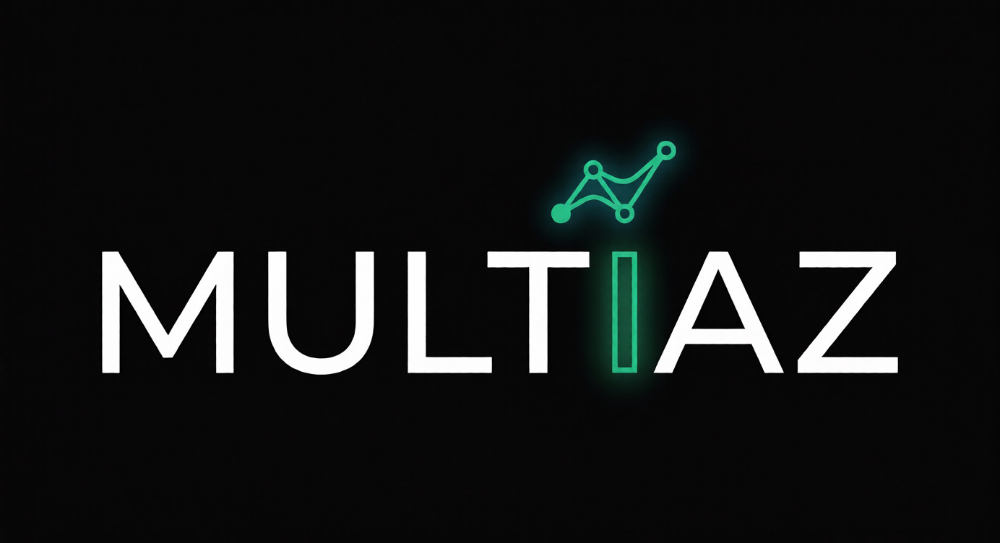
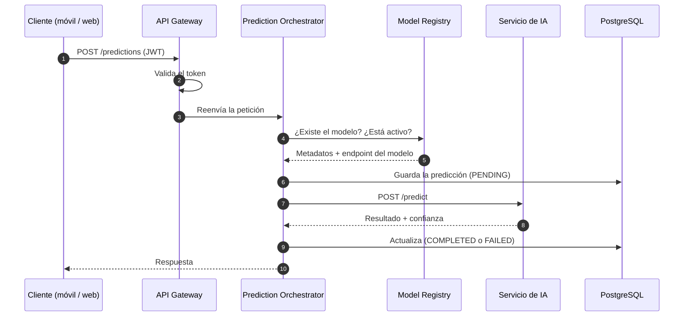
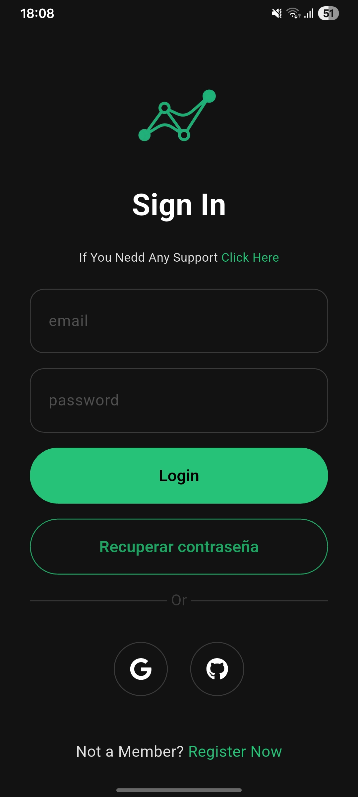
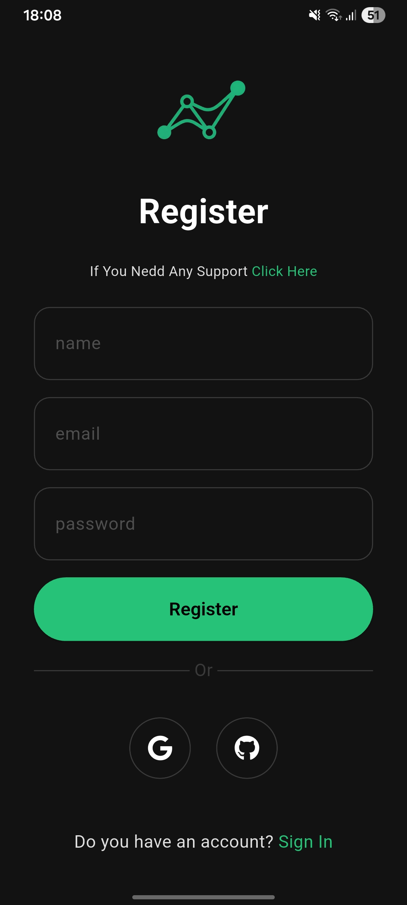

<p align="center"><strong>Español</strong> · <a href="README.en.md">English</a></p>

<div align="center">
    
    <h3>Plataforma para operar modelos de IA como plugins</h3>
    <br/>
    
    
    <br/><br/>
    
    
    
    
    
    <br/>
    
    
    
    
    
    
</div>

<br/>

> **MultIAZ** es una plataforma de microservicios para **registrar, servir y operar modelos de IA** detrás de un único punto de entrada. Cada modelo es un servicio independiente que cumple un contrato común, así que se puede agregar, activar o retirar un modelo sin tocar el resto del sistema.

---

## Tabla de contenidos

- [¿Por qué existe?](#por-qué-existe)
- [Cómo funciona una predicción](#cómo-funciona-una-predicción)
- [Estado actual](#estado-actual)
- [Decisiones de arquitectura](#decisiones-de-arquitectura)
- [Estructura del monorepo](#estructura-del-monorepo)
- [Ejecutar en local](#ejecutar-en-local)
- [Roadmap](#roadmap)
- [Documentación](#documentación)
- [Autor](#autor)

---

## ¿Por qué existe?

Entrenar un modelo es la parte fácil. Lo difícil empieza cuando hay **varios modelos en producción**, cada uno con su API, su versión, su forma de fallar y su propio consumo. Sin una capa común, cada cliente termina hablando directamente con cada modelo y el sistema se vuelve imposible de mantener.

MultIAZ es esa capa común:

- **Un solo punto de entrada.** Los clientes (app móvil y panel web) solo conocen el API Gateway, nunca la dirección de un modelo.
- **Modelos como plugins.** Un modelo nuevo se registra en el *Model Registry* y el orquestador lo enruta sin cambios en el código.
- **Ciclo de vida controlado.** Un modelo puede estar activo o inactivo, y el orquestador rechaza las peticiones a modelos inactivos.
- **Trazabilidad.** Cada predicción queda guardada con su entrada, su salida, su estado y sus tiempos.
- **Seguridad centralizada.** La autenticación con JWT se valida en el gateway, no en cada servicio.
- **Configuración centralizada.** Cada servicio lee su configuración por entorno (dev, staging, prod) desde el Config Service.

El valor del proyecto está en **la plataforma que opera los modelos**, no en un modelo en particular: cualquier servicio que cumpla el contrato común (`GET /health` y `POST /predict`, con respuesta `{ result, confidence }`) se puede conectar.

---

## Cómo funciona una predicción



Los servicios se descubren entre sí con **Eureka**, así que ninguno tiene direcciones escritas a mano.

> Diagrama completo de los 26 componentes: [`ARQUITECTURA_INICIAL_MULTIAZ.md`](docs/architecture/ARQUITECTURA_INICIAL_MULTIAZ.md)

---

## Estado actual

El proyecto está en desarrollo activo. Esta tabla separa lo que ya funciona de lo que está planeado.

| Componente | Estado |
|---|---|
| API Gateway (Spring Cloud Gateway) | ✅ Implementado |
| Auth Service (registro, login, JWT, Flyway, tests) | ✅ Implementado |
| Service Discovery (Eureka) y Config Service | ✅ Implementados |
| Model Registry | ✅ Implementado |
| Prediction Orchestrator | 🟡 En integración con los servicios de IA |
| Servicios de IA conectables (FastAPI, contrato común) | 🟡 Contrato definido, en integración con el orquestador |
| Docker Compose (servicios, bases de datos, RabbitMQ, MinIO, backups) | ✅ Implementado |
| CI con GitHub Actions (backend y frontend) | ✅ Implementado |
| Admin Web App (React + TypeScript) | 🟡 Login listo, dashboard en desarrollo |
| App móvil (Flutter) | 🟡 Login, registro e inicio |
| Dataset Management, Prediction Storage, Scheduler, Notification, Logging & Monitoring | ⚪ Estructura base creada |
| Training Service | ⚪ Planeado |
| Observabilidad con ELK, Kubernetes | ⚪ Planeado |

---

## Decisiones de arquitectura

Cada decisión importante está documentada como ADR en [`docs/adr/`](docs/adr/), con contexto, alternativas y consecuencias.

| ADR | Decisión |
|---|---|
| 001 | Refinamiento progresivo de la arquitectura |
| 002 | Docker en desarrollo, Kubernetes diferido a producción |
| 003 | Vitest en lugar de Jest |
| 004 | Versión fija de axios ante ataques a la cadena de suministro |
| 005 | Flyway como estándar de migraciones |
| 006 | pnpm en lugar de npm por seguridad de dependencias |
| 007 | React Router para la navegación del panel |

### ¿Por qué microservicios?

Con pocos modelos, un monolito sería más simple. Elegí microservicios porque el objetivo es que **cada modelo se despliegue, escale y falle por separado**: un modelo de Python que se cae o tarda no debe tumbar la autenticación ni a los demás modelos. El costo es real: más infraestructura, más latencia entre servicios y depuración distribuida. Por eso Kubernetes y ELK están diferidos hasta que el flujo principal esté completo ([ADR-002](docs/adr/)).

---

## Estructura del monorepo

```
multiaz/
├── backend/
│   ├── core/              # Microservicios Java / Spring Boot
│   ├── ia-services/       # Un servicio FastAPI por modelo
│   ├── infrastructure/    # Eureka, Config Service, backups
│   └── training-service/
├── frontend/
│   ├── admin-web-app/     # Panel de administración (React + TS)
│   └── mobile-app/        # App para usuarios finales (Flutter)
├── config/                # Configuración por entorno (dev, staging, prod)
├── docker/                # docker-compose y variables de entorno
├── docs/                  # Arquitectura, ADRs, producto, sprints
└── scripts/               # Backups e inicialización de bases de datos
```

---

## Ejecutar en local

**Requisitos:** Docker y Docker Compose, Java 21, Python 3.12, Node.js 24 con pnpm, Flutter 3.41.

```bash
# 1. Clonar el repositorio
git clone https://github.com/zhunio2003/multiaz.git
cd multiaz

# 2. Crear el archivo de variables de entorno y completar las credenciales
cp docker/.env.example docker/.env

# 3. Levantar todo el sistema
docker compose -f docker/docker-compose.yml up -d

# 4. Verificar que los contenedores estén corriendo
docker compose -f docker/docker-compose.yml ps
```

| Servicio | URL |
|---|---|
| API Gateway | http://localhost:8080 |
| Eureka (servicios registrados) | http://localhost:8761 |
| Config Service | http://localhost:8888 |
| RabbitMQ Management | http://localhost:15672 |
| MinIO Console | http://localhost:9001 |

---

## Roadmap

1. **Flujo de predicción de punta a punta:** cliente → gateway → orquestador → modelo → resultado guardado.
2. **Panel de administración conectado al backend:** dashboard con datos reales, gestión de modelos y usuarios.
3. **Operación de modelos:** activar y desactivar, versiones, métricas de latencia y errores por modelo.
4. **Datasets y reentrenamiento:** carga y versionado de datasets, entrenamiento y comparación de métricas.
5. **Observabilidad y despliegue:** logs centralizados con ELK y despliegue en Kubernetes.

---

## Documentación

| Documento | Contenido |
|---|---|
| [Arquitectura detallada](docs/architecture/ARQUITECTURA_DETALLADA_MULTIAZ.md) | Los 26 componentes y las responsabilidades de cada uno |
| [Diagrama de despliegue](docs/architecture/deployment/DIAGRAMA_DESPLIEGUE_MULTIAZ.md) | Contenedores, puertos, redes y volúmenes |
| [Design System](docs/guides/DESIGN_SYSTEM_MULTIAZ.md) | Identidad visual y tokens de diseño |
| [Product Vision Board](docs/product/PRODUCT_VISION_BOARD_MULTIAZ.md) | Visión, usuarios y objetivos |
| [Technology Stack](docs/product/TECHNOLOGY_STACK_MULTIAZ.md) | Tecnología elegida para cada componente |
| [Definition of Done](docs/product/DEFINITION_OF_DONE_MULTIAZ.md) | Criterios para dar una historia por terminada |
| [ADRs](docs/adr/) | Registro de decisiones de arquitectura |
| [Sprints](docs/sprints/) | Artefactos de Scrum |

---

## Capturas

| Login (móvil) | Registro (móvil) |
|---|---|
|  |  |

---

## Autor

**Miguel Angel Zhunio Remache**

- GitHub: [zhunio2003](https://github.com/zhunio2003)
- LinkedIn: [Miguel Angel Zhunio Remache](https://www.linkedin.com/in/miguel-angel-zhunio-remache-753298330/)
